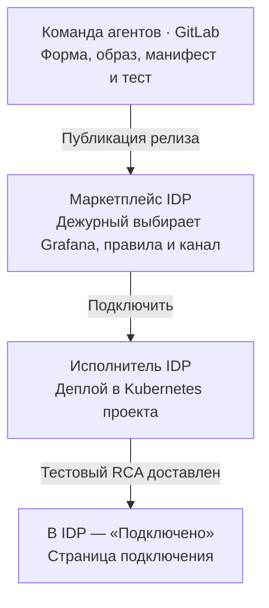

# Общая спецификация маркетплейса агентов для корпоративной IDP

**Основной вариант пилота — IDP сама разворачивает релиз в своём Kubernetes-кластере.**

Дежурный открывает в проекте `team-checkout` карточку «Подключить SRE-агента к алертам Grafana», выбирает Grafana, правила HTTP 5xx и канал для отчётов, затем нажимает **«Подключить»**. Маркетплейс сохраняет заказ в IDP. Её исполнитель устанавливает SRE-адаптер в окружении проекта и проверяет доставку тестового RCA. Дежурный получает страницу подключения. Дальше каждое подходящее срабатывание правила автоматически запускает расследование.

**Граница между командами проходит по релизу.** Команда агентов передаёт описание карточки, исполняемый артефакт, контракт конфигурации и тест готовности. Команда IDP владеет формой, заказом, деплоем, статусом и выдачей ссылки. Обработчик Grafana, SRE-исследователь и доставка отчёта составляют рабочий путь продукта. В этом варианте IDP не вызывает `/orders` команды агентов.

[Каталог агентов](#каталог-агентов-и-их-спецификации) · [Состав поставки](#что-команда-агентов-передаёт-idp) · [Действия по кнопке](#как-idp-оформляет-заказ) · [Работа после выдачи](#что-происходит-после-выдачи-агента) · [Приёмка](#приёмка-первой-интеграции)

## Каталог агентов и их спецификации

Версия карточки связана с неизменяемым `offeringId`. Один релиз можно заказать для нескольких проектов или несколько раз для одного проекта. IDP различает версию продукта, заказ на выдачу и созданный экземпляр или подключение. После выдачи у поручений и расследований появляются собственные идентификаторы.

| Продукт и спецификация | Что выбирает сотрудник при заказе | Что открывается после выдачи | Описание релиза |
| --- | --- | --- | --- |
| [Помощник команды](agents/team-assistant.md) · `agent-support-1-1` | Формат и размер сводки, при необходимости базу знаний | Диалог для передачи смены | [YAML](examples/agent-offering.yaml) |
| [Чат-агент для поручений в GitLab](agents/chat-task-agent.md) · `chat-task-agent-v1` | Зарегистрированное подключение GitLab и целевой репозиторий | Диалог, в котором можно поручить создание задачи и получить ссылку на неё | [YAML](examples/chat-task-agent-offering.yaml) |
| [Подключить SRE-агента к алертам Grafana](agents/sre-grafana.md) · `sre-grafana-v1` | Зарегистрированную Grafana, правила HTTP 5xx и канал RCA | Страница подключения с результатом теста и историей расследований | [YAML](examples/sre-grafana-offering.yaml) |

## Схема интеграции



[Редактируемая схема draw.io](marketplace.drawio) · [Два потока SRE в Mermaid](architecture.md) · [Интерактивный макет карточки и формы](marketplace-preview.html). В макете кнопка показывает конфигурацию, которую IDP подготовит для развёртывания. После изменения исходных документов встроенные копии обновляются командой `python3 scripts/sync-preview-docs.py`.

## Что команда агентов передаёт IDP

Для подключения нового продукта инженер IDP получает ссылки на спецификацию и YAML конкретного релиза. На примере SRE состав поставки следующий. Имена путей, коммит и digest в [примере релиза](examples/sre-grafana-offering.yaml) иллюстративны.

| Что передаёт команда агентов | Что с этим делает команда маркетплейса |
| --- | --- |
| **Карточка и схема формы.** `sre-grafana-v1`, назначение, владелец поддержки, типы полей и ограничения `parameterSchema`. | IDP импортирует версию в каталог. Подключения и каналы предлагает из проектных реестров. После выбора Grafana загружает правила именно этой организации. |
| **Готовый релиз.** Ссылка на GitLab с SHA коммита, образ адаптера по digest, Kubernetes-манифесты из того же коммита и описание входных значений. При принятом в IDP формате Helm — chart, значения по умолчанию и схема values. | Исполнитель IDP выбирает namespace и устанавливает зафиксированный релиз. Во время установки администратор не собирает образ и не выбирает ветку. |
| **Конфигурация и права.** Контракт `connection.yaml`, перечень env, секретных ссылок, портов и необходимых сетевых доступов. Для пилота `RCA_API_BASE_URL` — адрес существующего исследователя, `RCA_API_TOKEN` — его проектные учётные данные. | IDP формирует конфигурацию из контекста проекта и формы, подставляет адрес RCA из среды и токен из хранилища секретов. Владелец Grafana предоставляет полномочия на настройку маршрута либо заранее подготовленный маршрут. |
| **Точка входа и сквозной тест.** Адаптер обслуживает страницу подключения с проверкой доступа. В релизе указаны путь страницы, процедура теста, контрольные данные и признаки успешной доставки. | IDP публикует внутренний маршрут с SSO, запускает поставленный тест и читает его итог. При успехе показывает ссылку с идентификатором этого подключения. При окончательном сбое показывает шаг, причину и номер своего заказа. |

По переданному контракту уже существует RCA API `/v1/investigations`. Образ адаптера, автоматическую настройку интеграции Grafana, страницу подключения, доставку и сквозной тест ещё предстоит реализовать и передать со стендовыми реквизитами.

## Как IDP оформляет заказ

Для пилота предлагаем один экземпляр адаптера на подключение, стабильный `connectionId` и namespace, заранее связанный с проектом. Названия внутренних состояний и способ запуска исполнителя определяет действующая IDP.

| Шаг | Исполнитель и вход | Результат |
| --- | --- | --- |
| 1. Проверить выбор | Сервер IDP берёт проект и сотрудника из сессии. Проверяет право на подключение, схему полей, принадлежность Grafana, каждого правила и канала проекту. | При устаревшем или недоступном выборе IDP предлагает обновить форму. Частичное подключение не создаётся. |
| 2. Зафиксировать заказ | По кнопке IDP сохраняет одно действие, `connectionId`, версию релиза, исходный выбор и целевое окружение. | Двойное нажатие и повтор после потери ответа возвращают к той же записи IDP. Намеренное новое подключение получает новый ID. |
| 3. Развернуть | Исполнитель IDP подставляет значения, применяет манифесты или Helm-релиз в namespace проекта и подключает конфигурацию и секреты. При повторном запуске сверяет имеющиеся ресурсы по сохранённому ID. | Kubernetes запускает закреплённый образ. В заказе IDP видно «Подключается». Страница подключения может открываться по SSO ещё с пустой историей. |
| 4. Привязать правило и проверить | Шаг из релиза настраивает аутентифицированный webhook выбранных правил. Затем IDP выполняет сквозной тест из поставки. Синтетический HTTP 5xx идёт через Grafana, адаптер, исследователь и доставку в выбранный канал. | В примере IDP ждёт успешного завершения тестового Kubernetes Job. Тест возвращает успех только после ответа исследователя и подтверждения канала, сохраняя `request_id` и квитанцию. Готовность Pod подтверждает запуск контейнера. |
| 5. Выдать результат | IDP сохраняет в своём заказе итог и ссылку, составленную из внутреннего адреса маршрута и пути страницы подключения. | При успехе — **«Подключено»** и **«Открыть подключение»**. При временной неготовности проверка продолжается для того же подключения. При окончательной ошибке видны причина и номер заказа IDP. Закрытие страницы не останавливает работу исполнителя. |

### Пример конфигурации SRE-адаптера

Ниже конфигурация одного развёртывания, которую показывает и HTML-макет. Для примера адаптер может читать её из `connection.yaml` в ConfigMap. `projectId` задаёт IDP, `connectionId` она выделяет один раз. Последние три значения выбирает дежурный.

```json
{
  "projectId": "team-checkout",
  "connectionId": "conn-checkout-01",
  "grafanaConnectionId": "grafana-checkout",
  "ruleUids": [
    "checkout-5xx"
  ],
  "deliveryChannelId": "rca-checkout"
}
```

Адаптер по доверенному идентификатору подключения сверяет права и получает организацию Grafana, привязку правила к сервису, UID логов, трассировок и метрик и шаблон ссылки на логи. Служебные токены передаются отдельно через ссылку на секрет. Путь в поставке вида `/connections/{connectionId}` определяет, какую страницу открывать. Фактический адрес и SSO настраивает IDP.

## Что именно получает проект

| Продукт | Что проверяет IDP по тесту из релиза | Первый наблюдаемый результат |
| --- | --- | --- |
| Агент с диалогом | Инициатор может открыть чат, контрольное сообщение получает ответ. Если заявлены инструменты или базы — проверен доступ в пределах проекта. | Ответ на заметку либо результат конкретного поручения. |
| SRE-агент | Тестовый алерт выбранного правила прошёл через сервис расследований, канал подтвердил публикацию отчёта. | Страница подключения и тестовый RCA в выбранном канале. |
| База знаний | Пустая база доступна инициатору, загрузка первого документа работает. | Сотрудник загружает документ. После индексации он доступен поиску. |
| RAG-сервис | Поиск работает по всем выбранным базам с правами пользователя. При успешном пустом поиске сервис сообщает об отсутствии совпадений. | Ответ по материалам или сообщение об отсутствии подходящих материалов. |

Если модель пока не отвечает или одна из баз временно недоступна, IDP продолжает проверку без кнопки открытия. При отзыве прав выдача останавливается, а сотрудник видит безопасную причину. После выдачи права вошедшего пользователя проверяются и при использовании ресурса.

## Что происходит после выдачи агента

### Ответ в чате

В «Помощнике команды» дежурный просит подготовить передачу смены и прикладывает заметку «На тестовом стенде обновили сервис. Утром нужно проверить вход». Агент выдаёт сводку в формате из заказа. Обновление входит в выполненные работы, проверка входа — в задачи следующей смены. Если подключена база знаний, поиск учитывает права вошедшего пользователя. Для этой карточки полезный результат находится в самом ответе.

### Поручение в чате с действием во внешней системе

В предлагаемой карточке «Чат-агент для поручений в GitLab» указываются две ссылки — `gitlabConnectionId` и `targetRepositoryId`. Первая определяет разрешённое подключение, вторая — репозиторий, в котором агенту разрешено создавать задачи. Репозиторий с исходниками самого агента задаёт команда агентов при выпуске релиза. Все секреты остаются у сервисов.

Пример конфигурации экземпляра, которую IDP передаёт исполнителю для чат-агента с правом создавать задачи в выбранном репозитории.

```json
{
  "projectId": "team-checkout",
  "offeringId": "chat-task-agent-v1",
  "parameters": {"gitlabConnectionId": "gitlab-demo", "targetRepositoryId": "repo-demo"}
}
```

1. **Выдача.** Сотрудник заказывает экземпляр и открывает чат по ссылке из заказа IDP. Готовность означает, что инициатор может войти в чат, а агент может принять поручение для выбранного репозитория. Проверку полномочий на запись повторяют при каждом действии.
2. **Поручение.** Сотрудник пишет «Создай задачу „Проверить ошибки 503 после релиза“». Агент связывает поручение с пользователем, экземпляром и целевым репозиторием. Если работа выполняется в фоне, в чате видно, что поручение принято.
3. **Результат.** После подтверждения от GitLab агент возвращает номер и ссылку на созданную задачу. Сотрудник открывает её в выбранном репозитории. При отказе в правах агент сообщает причину. Если ответ на операцию создания потерялся, исполнитель сначала сверяет результат исходного поручения. При неопределённом исходе показывает его пользователю.
4. **Повтор.** У поручения свой устойчивый идентификатор. Повтор доставки того же сообщения относится к той же работе. IDP отдельно связывает выдачу экземпляра с первоначальным действием в карточке. Ошибка одного поручения отражается в чате, а завершённый заказ сохраняет свой статус.

Та же модель применима к чат-агенту, который по просьбе сотрудника запускает разрешённую проверку или готовит артефакт. В его собственной спецификации перечисляются поддерживаемые действия, разрешённые цели, нужные права и подтверждение выполнения, которое увидит сотрудник. [Спецификация чат-агента для поручений](agents/chat-task-agent.md)

### Автоматическое действие по событию

Для SRE-карточки дежурный один раз выбирает `grafanaConnectionId`, `ruleUids` и `deliveryChannelId`. Адаптер регистрирует подключение проекта. Из конфигурации Kubernetes он получает адрес исследователя, из хранилища секретов — служебные полномочия. По ссылке в заказе дежурный открывает страницу подключения, доступную до первого боевого алерта.

| Когда | Что делает интеграция | Что видит дежурный |
| --- | --- | --- |
| При подключении | Проверяет права проекта на Grafana, правила, источники и канал. Для каждого правила фиксирует целевой сервис, UID логов, трассировок и метрик и способ построить ссылку на логи. Пропускает синтетический сигнал через выбранное правило и проверяет доставку тестового RCA. | «Подключено», страница с настройками и результатом теста. При приёмке дежурный действительно видит тестовый RCA в выбранном канале. |
| При уведомлении | Адаптер разбирает каждый элемент `alerts[]` отдельно. Для подходящего `firing` сохраняет эпизод и `request_id`, берёт из этого алерта метки `api_name`, `api_method`, `api_endpoint`, `app_name`, `code`, дополняет их проверенным профилем и вызывает `POST /v1/investigations`. | Одно расследование на эпизод. Повтор webhook сохраняет исходный ID. |
| При завершении | Для `completed` и `insufficient_evidence` работник доставки берёт `summary` и `report`. При обрыве, `409 investigation_in_progress` или `504 http_wait_timeout` сначала читает результат по `GET /v1/investigations/{request_id}`. | В выбранном канале — отчёт либо сообщение о недостатке доказательств. Сбой доставки можно устранять отдельно от расследования. |

Действующий исследователь принимает запросы на расследование. Регистрация подключения, приём сырого webhook, адаптер и доставка в канал описаны как предлагаемая интеграция. Поля HTTP 5xx, пример тела, повтор запросов и изоляция двух проектов разобраны в [спецификации SRE-агента](agents/sre-grafana.md).

## Как добавить следующего агента

Скопируйте [шаблон спецификации нового агента](agents/TEMPLATE.md) в каталог `agents/` и заполните его для выбранного релиза. Передайте команде маркетплейса две ссылки — на заполненную спецификацию и на YAML релиза с `parameterSchema`. Добавьте их в строку продукта в каталоге в начале этого документа.

Для новой версии с изменившимися параметрами, артефактом или поведением используется новый `offeringId`. Уже оформленные заказы сохраняют ссылку на свою версию.

| Что заполнить в спецификации агента | Что должно стать понятно инженеру IDP |
| --- | --- |
| Задача сотрудника и способ запуска | Когда заказывают продукт и что затем запускает работу — вопрос, поручение или внешнее событие. |
| Карточка, версия и форма | Где релиз в GitLab, кто владелец, какие поля показывает IDP, откуда берутся варианты выбора и кто проверяет права на них. |
| Размещение и полномочия | Что создаётся в Kubernetes IDP, какие настройки и ссылки на секреты предоставляет среда, от чьего имени агент обращается к внешней системе. |
| Готовность и точка входа | Какой тест запускает IDP, по какому результату показывает «Готов» и какой адрес ресурса привязывает к заказу. |
| Действия после выдачи | Допустимые действия, результат для сотрудника, право на каждое действие, собственный ID поручения или события, правила повторов и обработки ошибок. |
| Приёмка и владелец поддержки | Один сквозной пример с наблюдаемым результатом, случай отсутствия прав и случай потерянного ответа. Отдельно отметить, какая часть уже работает и что предложено для пилота. |

Для нового агента с уже поддерживаемым способом размещения достаточно описания версии, формы, исполняемого артефакта и продуктовой проверки. При добавлении интеграции с внешней системой команда агентов также поставляет адаптер и описывает права исполнителя.

## Почему предлагаем такой сценарий

В Microsoft Agent Store команда-разработчик передаёт агента на публикацию в каталог организации. Администратор проверяет его возможности и доступ к данным, а сотрудники находят доступного им агента. В Gemini Enterprise сотрудник может найти агента по назначению среди тех, которыми поделилась его команда, и открыть диалог из карточки. Для нашей интеграции отсюда два вопроса к владельцу IDP — как предложение попадёт в действующий каталог и кому будет видна его карточка. [Microsoft Agent Store](https://learn.microsoft.com/en-us/copilot/manage/copilot-agent-store) · [Gemini Enterprise Agent Gallery](https://docs.cloud.google.com/gemini/enterprise/docs/agent-gallery)

Для сценария с отдельным экземпляром в проекте важны также версии шаблона, ход выдачи и доступность точки входа.

- **Timeweb Cloud.** При заказе агента выбирают проект, а базу знаний можно подключить сразу или позже. После нажатия «Заказать» запуск занимает время. Для IDP отсюда берём выбор базы в карточке и видимый статус подготовки. [Создание AI-агента](https://timeweb.cloud/docs/ai-agents/manage-agents/create)
- **Yandex AI Studio.** Сохранение конфигурации создаёт версию агента. Эту версию можно протестировать и опубликовать в выбранном канале. У нас команда-поставщик готовит версию заранее, а успешный заказ означает, что сотруднику уже доступен канал для работы. [Версии и публикация агента](https://aistudio.yandex.ru/ru/docs/ai-studio/concepts/agents/text-agents)
- **AWS.** В Service Catalog вызов `ProvisionProduct` принимает идентификатор предложения и ключ повторного запроса. Ход выдачи читается через `DescribeRecord`. В Bedrock опубликованную версию агента можно вызывать через стабильный alias. Для IDP предлагаем отдельные идентификаторы заказа и готового ресурса. [AWS Service Catalog](https://docs.aws.amazon.com/servicecatalog/latest/APIReference/API_ProvisionProduct.html) · [Amazon Bedrock](https://docs.aws.amazon.com/bedrock/latest/userguide/agent-tutorial-step4.html)
- **Google Cloud.** В Conversational Agents можно выбрать проект и создать агента из готового шаблона. Это соответствует роли поставщика в нашей схеме — он готовит шаблон, а сотрудник заказывает экземпляр. [Создание агента из шаблона](https://docs.cloud.google.com/dialogflow/cx/docs/concept/console-conversational-agents#create_an_agent)

## Приёмка первой интеграции

На стенде команды подставляют в пример реальный GitLab-коммит, доступный образ и манифесты, настраивают namespace, проектные полномочия и тестовый канал. Для проверки кнопки прослеживают одно действие от формы до результата.

1. **Установка.** Дежурный выбирает Grafana, правило и канал, нажимает «Подключить». IDP сохраняет заказ, создаёт одно подключение и устанавливает ожидаемый digest в namespace проекта. В истории своего заказа показывает этап установки.
2. **Потеря ответа и перезапуск.** Повторить клик и перезапустить исполнителя после создания ресурсов. Ожидать один `connectionId`, одно размещение и один маршрут Grafana. После закрытия страницы заказ можно снова открыть. Новая версия релиза в каталоге не меняет начатую выдачу.
3. **Права.** Подставить правило, базу или канал другого проекта. IDP отклоняет выбор до выдачи, а адаптер проверяет соответствие источников проекту при использовании. Вход под пользователем другого проекта не даёт доступа к результату.
4. **Готовность SRE.** Успешно запустить Pod, временно нарушить доставку в тестовый канал. IDP показывает незавершённую проверку или причину окончательного отказа. После успешной проверки дежурный открывает страницу подключения и действительно видит тестовый RCA с тем же `request_id` в согласованном канале. Это критерий **«Подключено»**.
5. **Работа после выдачи.** Повторить один эпизод алерта. Адаптер дочитывает прежнее расследование и сверяет доставку отчёта. Для чат-агента с инструментом сотрудник получает ссылку на одну задачу в разрешённом GitLab-проекте. Для базы знаний и RAG проверить загрузку синтетического документа и ответ по его содержимому после индексации.

## Альтернатива для платформ с API заказов поставщика

[OpenAPI заказов поставщика](openapi.yaml) сохраняет отдельный вариант интеграции. В нём IDP отправляет `POST /orders` с `Idempotency-Key`, затем читает `GET /orders/{orderId}` и получает `resourceRef` или ошибку. Для основного сценария эта зависимость отсутствует. Заказ, статусы, повторы и ссылка принадлежат IDP. Рабочий вызов исследователя `POST /v1/investigations` нужен SRE-адаптеру при обработке алерта в обоих вариантах.

Если внешний контракт уже использовался, незавершённые заказы завершают прежним способом — с первоначальными версией API, телом, ключом и `orderId`. Новые заказы переключают на исполнитель IDP отдельно, чтобы один клик не породил два развёртывания.

## Что согласовать с владельцем IDP

| Вопрос | Предложение для пилота и влияние |
| --- | --- |
| Как импортировать релиз и передавать входные данные исполнителю? | Начать с YAML описания версии, схемы формы и Kubernetes-манифеста или Helm chart. Согласовать способ подстановки значений и получения результата теста. |
| Как заказ переживает тайм-аут, закрытие страницы и повтор установки? | IDP сохраняет стабильный ID действия и `connectionId` до запуска, использует их для поиска существующей установки. |
| Кто связывает проект с namespace, источниками Grafana, каналом и правами? | IDP ведёт привязку окружения и проверяет сотрудника. Владелец мониторинга задаёт разрешённые источники и маршрут. Релиз описывает доступы, необходимые адаптеру. |
| Как передать адрес и как принять результат выдачи? | IDP задаёт внутренний адрес с SSO, дополняет его путём из релиза и показывает ссылку после сквозного теста. Договориться о сроке проверки, подтверждении доставки и контакте поддержки. |
