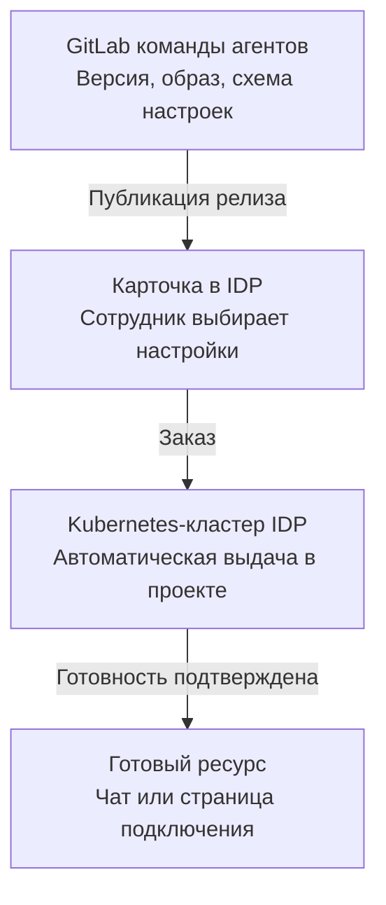

# Общая спецификация маркетплейса агентов для корпоративной IDP

**Предложение команды агентов для команды маркетплейса · контракт заказов 0.4 · на согласование**

Сотрудник один раз заказывает продукт в своём проекте. Дальнейшая работа зависит от карточки. «Помощник команды» отвечает в диалоге. Чат-агент для поручений по просьбе сотрудника создаёт задачу в GitLab и возвращает ссылку на неё. SRE-агент после подключения реагирует на алерты Grafana и доставляет отчёты в выбранный канал.

**Команда агентов** готовит код, образ, схему настроек и описание каждого релиза в GitLab. **Команда маркетплейса** ведёт каталог, строит форму, передаёт заказ в контексте проекта и показывает результат. Экземпляр агента или адаптер подключения работает в Kubernetes-кластере IDP. По кнопке запускается автоматика. Владелец продукта отвечает за готовность и последующее поведение агента.

Для согласования с IDP предлагаем общий API заказов по HTTPS. Поля, коды HTTP и примеры поддерживаются в [OpenAPI](openapi.yaml). Формат импорта карточек, привязку проекта к namespace и служебные полномочия предстоит подтвердить с владельцами платформы.

[Каталог и спецификации агентов](#каталог-агентов-и-их-спецификации) · [Выдача через IDP](#как-idp-оформляет-заказ) · [Работа после выдачи](#что-происходит-после-выдачи-агента) · [Как добавить агента](#как-добавить-следующего-агента) · [Приёмка](#приёмка-первой-интеграции)

## Каталог агентов и их спецификации

Карточка описывает продукт. Неизменяемый `offeringId` закрепляет версию. `orderId` относится к одной попытке выдачи с её повторами, `resourceRef.id` — к созданному экземпляру или подключению. Один релиз можно заказать несколько раз. Задачи в чате и расследования по алертам учитываются отдельно от заказа.

| Продукт и спецификация | Что выбирает сотрудник при заказе | Что открывается после выдачи | Описание релиза |
| --- | --- | --- | --- |
| [Помощник команды](agents/team-assistant.md) · `agent-support-1-1` | Формат и размер сводки, при необходимости базу знаний | Диалог для передачи смены | [YAML](examples/agent-offering.yaml) |
| [Чат-агент для поручений в GitLab](agents/chat-task-agent.md) · `chat-task-agent-v1` | Зарегистрированное подключение GitLab и целевой репозиторий | Диалог, в котором можно поручить создание задачи и получить ссылку на неё | [YAML](examples/chat-task-agent-offering.yaml) |
| [Подключить SRE-агента к алертам Grafana](agents/sre-grafana.md) · `sre-grafana-v1` | Зарегистрированную Grafana, правила HTTP 5xx и канал RCA | Страница подключения с результатом теста и историей расследований | [YAML](examples/sre-grafana-offering.yaml) |

## Схема интеграции

[Открыть редактируемую схему draw.io](marketplace.drawio). На отдельных вкладках показаны выдача через IDP, поручение в чате и обработка алерта Grafana.

[Открыть интерактивный макет](marketplace-preview.html). В форме каждой карточки доступны для чтения общий контракт, API заказов, спецификация агента и параметры релиза. После изменений в документации обновите встроенные копии командой `python3 scripts/sync-preview-docs.py`.



У каждого продукта свои условия готовности и первый полезный результат. Для событийного агента отдельно показаны разовое подключение и повторяющаяся обработка сигналов. [Две схемы SRE-агента](architecture.md)

### Что команда агентов передаёт маркетплейсу

Для пилота предлагаем выпускать из GitLab описание конкретной версии на основе существующей спецификации агента. Пример показывает поля для импорта карточки и привязку к исполняемому образу. Адреса и контрольные суммы вымышлены. [Пример описания релиза](examples/agent-offering.yaml)

| Что входит в описание | Как это используют команды |
| --- | --- |
| `offeringId`, `resourceType`, `title`, `description`, `owner` | Поставщик присваивает версии неизменяемый ID. IDP показывает назначение продукта и команду поддержки, связывает кнопку с этой версией. |
| `parameterSchema`, `acceptsKnowledgeBases` | Спецификация агента задаёт поля формы, подписи, типы, обязательность, допустимые значения и значения по умолчанию. Отдельный признак управляет выбором доступных баз. Сервер IDP и поставщик проверяют ввод по одной версии схемы. |
| `source.repository`, `source.commit`, `deployment.manifestPath`, `deployment.image` | Поставщик фиксирует репозиторий, точный коммит, путь к описанию развёртывания в этом коммите и собранный образ по digest. По этим данным исполнитель запускает выбранный релиз. |

При выпуске версии команда агентов собирает образ, сохраняет привязку к релизу у себя и передаёт файл команде IDP для импорта в каталог. После импорта карточка становится доступна разрешённым проектам. Способ автоматической публикации зависит от возможностей существующего каталога. Изменение схемы настроек, образа или описания развёртывания требует нового `offeringId`. Публикация сама по себе не создаёт экземпляров в проектах.

### Где работает заказанный экземпляр

Агент работает в Kubernetes-кластере IDP. Для пилота предлагаем привязать каждый подключённый проект к заранее выделенному пространству имён (namespace) внутри этого кластера. Например, проекту `team-demo` соответствует площадка `runtime-team-demo` и namespace `team-demo`. При подключении проекта IDP задаёт привязку и предоставляет служебной учётной записи исполнителя права на развёртывание. Каждый последующий заказ использует эту привязку автоматически. Идентификатор площадки доступен маркетплейсу в `deploymentTargetId`.

До регистрации сервис заказов определяет площадку по `projectId`. При регистрации он фиксирует её вместе с версией релиза и итоговыми настройками. Если для проекта не настроено размещение, IDP получает `422 deployment_target_not_configured` и может направить обращение владельцу площадки. Если реестр привязок временно недоступен, IDP повторяет запрос после `503` с прежним ключом.

Зарегистрированный заказ автоматически поступает исполнителю. Для отдельного экземпляра он применяет описание из зафиксированного коммита в namespace проекта, а Kubernetes запускает образ по digest. Для подключения к уже работающему адаптеру исполнитель регистрирует конфигурацию проекта. Секреты предоставляет площадка по согласованному механизму. Сервис заказов выставляет `succeeded` после продуктовой проверки готовности. При окончательной ошибке IDP получает `failed` и причину по прежнему `orderId`.

## Как IDP оформляет заказ

| Шаг | Действие и источник данных | Что показывает IDP |
| --- | --- | --- |
| 1. Открыть карточку | IDP читает описание версии. Проект и сотрудника берёт из своей сессии и проверяет право заказа. | Назначение, команда поддержки, текущий проект и поля формы. Сотрудник выбирает только доступные проекту подключения или базы. |
| 2. Отправить заказ | По кнопке «Создать агента» или «Подключить» сервер IDP сохраняет ключ и исходное тело, затем вызывает `POST /orders`. Поставщик проверяет полномочия, ссылки и значения формы. | По `202` с `queued` — «Принят». IDP сохраняет `orderId`. При повторе с ответом `200` показывает полученное состояние того же заказа. |
| 3. Дождаться готовности | Исполнитель автоматически запускает экземпляр или настраивает проектное подключение через адаптер в Kubernetes IDP. Сервис заказов проводит проверку, указанную в спецификации продукта. IDP читает `GET /orders/{orderId}`. | `queued` — «Принят», `in_progress` — «Создаётся». Пока идёт проверка, ссылки на ресурс нет. Быстрый заказ может завершиться между двумя чтениями. |
| 4. Открыть ресурс | При `succeeded` IDP показывает ссылку из `resourceRef.url`. При `failed` завершает опрос и показывает `error.message` и `orderId` для поддержки. | Для чат-агента — «Готов» и «Открыть агента». Для SRE — «Подключено» и «Открыть подключение». Сам ресурс при открытии проверяет SSO и право вошедшего пользователя. |

### Из чего IDP собирает заказ

В примере версии `agent-support-1-1` сотрудник выбирает обязательный формат сводки — короткий текст (`brief`) или список (`checklist`). Поле «Максимум пунктов в сводке» принимает целое число от 1 до 10, по умолчанию 5. Ниже сотрудник выбрал список и оставил лимит по умолчанию. В заказ сервер IDP подставляет `projectId` из контекста проекта, `requesterId` из проверенной сессии, тип и версию из карточки.

```json
{
  "projectId": "team-demo",
  "requesterId": "user-demo",
  "offeringId": "agent-support-1-1",
  "resourceType": "agent",
  "parameters": {
    "summaryFormat": "checklist"
  }
}
```

Поставщик подставляет 5 для пропущенного `itemLimit` и проверяет итоговый набор по `parameterSchema` этой версии. Неизвестное поле, неверный тип или пропуск обязательной настройки без значения по умолчанию дают `422 invalid_configuration` до регистрации. В ответ на первый запрос этот экземпляр должен сформировать список максимум из пяти пунктов. Для карточки без обязательных настроек сотруднику по-прежнему достаточно одного нажатия.

Поле `knowledgeBaseIds` заполняется выбором сотрудника. В карточке агента выбор зависит от шаблона и может быть пропущен, в карточке RAG-сервиса нужна хотя бы одна база. При заказе пустой базы IDP опускает поле. Для списка IDP может взять `resourceRef.id` ранее выданных проекту баз и отфильтровать их по текущим правам сотрудника.

Сервер IDP передаёт служебный токен в заголовке `Authorization`. Поставщик принимает `requesterId` от доверенного клиента и сверяет права указанного сотрудника с согласованным источником.

### Если ответ на заказ потерялся

До первого вызова сервер IDP сохраняет версию API, `Idempotency-Key` и точное тело в записи действия, доступной после перезагрузки страницы. Двойное нажатие относится к одной такой записи. При тайм-ауте, обрыве связи или `503` IDP повторяет сохранённый запрос с тем же ключом. Поставщик либо впервые принимает заказ (`202`), либо возвращает тот же `orderId` и текущее состояние (`200`), в том числе уже готовый результат. Обновление служебного токена сохраняет идентичность клиента. Изменение тела с занятым ключом даёт `409`. Для действия «Создать ещё одного» IDP выдаёт новый ключ, даже если шаблон и проект прежние.

Если `orderId` уже известен, после закрытия страницы или сбоя опроса IDP продолжает `GET` по этому ID. При тайм-ауте чтения или `503` она сохраняет последнее известное состояние. Если ответы приходят вразнобой, IDP сохраняет наиболее поздний подтверждённый этап заказа. `401` требует восстановить служебную аутентификацию, а `404` при чтении означает, что заказ недоступен этому клиенту. Перед показом сохранённого заказа IDP заново проверяет права текущего сотрудника в проекте.

### Если выбранная база недоступна

IDP фильтрует список. Если при отправке формы её сервер обнаруживает отзыв права, он предлагает сотруднику обновить выбор и останавливает отправку. Для поступившего заказа поставщик самостоятельно проверяет право IDP и инициатора заказывать в проекте, доступность версии предложения и право проекта и сотрудника подключить **каждую** базу. Если хотя бы одна база исчезла или недоступна, весь новый запрос получает `404 resource_not_found` без `orderId`. IDP показывает безопасное сообщение и предлагает обновить выбор. Исправленный заказ получает новый ключ. Для отсутствующей и чужой базы ответ совпадает. Отсутствие права заказывать в проекте даёт `403 access_denied`.

Если ответ на уже принятый запрос потерялся, право служебного клиента читать исходный заказ позволяет восстановить его по ключу. Поставщик повторно проверяет доступ к выбранным базам перед выдачей. Если право отозвали за это время, результатом будет `failed` с объяснением. После успешной выдачи поставщик проверяет актуальные права вошедшего пользователя при открытии и работе с материалами. Последующий отказ виден в интерфейсе ресурса, а история выдачи сохраняет `succeeded`.

## Что именно получает проект

| Карточка | Условие для `succeeded`, которое проверяет поставщик | Первое действие по `resourceRef.url` |
| --- | --- | --- |
| **Агент с диалогом** | Инициатор может войти в чат и получить ответ на контрольный запрос. Если заявлены инструменты, поставщик проверяет нужные подключения в рамках разрешений проекта. | «Открыть агента». Сотрудник задаёт вопрос или отдаёт поручение. |
| **Событийный SRE-агент** | Настроен маршрут выбранного правила Grafana. Тестовый сигнал прошёл через сервис расследований, канал подтвердил публикацию отчёта. | «Открыть подключение». Дежурный видит правила, результат проверки и историю расследований. |
| **База знаний** | У проекта есть отдельная пустая база с собственным `resourceRef.id`. Инициатор может открыть её и загрузить первый документ. Для выдачи достаточно работающей загрузки. | «Открыть базу знаний». Сотрудник загружает документ в интерфейсе поставщика. Поиск по его содержанию становится возможен после индексации. |
| **RAG-сервис** | Инициатору доступна точка входа. Запрос к сервису выполняет поиск по всем и только выбранным базам с учётом прав пользователя. При совпадении сервис может ответить по материалам. Успешный поиск без совпадений возвращает сообщение об отсутствии материалов. | «Открыть RAG-сервис». Сотрудник задаёт вопрос и видит ответ по доступным материалам либо результат пустого поиска. |

Если экземпляр агента уже создан, но модель пока не отвечает, или RAG-сервис временно не может опросить одну из баз, поставщик оставляет заказ в `in_progress` без `resourceRef`. Восстановление позволяет завершить тот же заказ. При окончательном отказе или исчерпании срока выдачи поставщик возвращает `failed` с безопасной причиной.

## Что происходит после выдачи агента

### Ответ в чате

В «Помощнике команды» дежурный просит подготовить передачу смены и прикладывает заметку «На тестовом стенде обновили сервис. Утром нужно проверить вход». Агент выдаёт сводку в формате из заказа. Обновление входит в выполненные работы, проверка входа — в задачи следующей смены. Если подключена база знаний, поиск учитывает права вошедшего пользователя. Для этой карточки полезный результат находится в самом ответе.

### Поручение в чате с действием во внешней системе

В предлагаемой карточке «Чат-агент для поручений в GitLab» указываются две ссылки — `gitlabConnectionId` и `targetRepositoryId`. Первая определяет разрешённое подключение, вторая — репозиторий, в котором агенту разрешено создавать задачи. Репозиторий с исходниками самого агента задаёт команда агентов при выпуске релиза. Все секреты остаются у сервисов.

Пример заказа для чат-агента с правом создавать задачи в выбранном репозитории.

```json
{
  "projectId": "team-demo",
  "requesterId": "user-demo",
  "offeringId": "chat-task-agent-v1",
  "resourceType": "agent",
  "parameters": {"gitlabConnectionId": "gitlab-demo", "targetRepositoryId": "repo-demo"}
}
```

1. **Выдача.** Сотрудник заказывает экземпляр и открывает чат по `resourceRef.url`. Готовность означает, что инициатор может войти в чат, а агент может принять поручение для выбранного репозитория. Проверку полномочий на запись повторяют при каждом действии.
2. **Поручение.** Сотрудник пишет «Создай задачу „Проверить ошибки 503 после релиза“». Агент связывает поручение с пользователем, экземпляром и целевым репозиторием. Если работа выполняется в фоне, в чате видно, что поручение принято.
3. **Результат.** После подтверждения от GitLab агент возвращает номер и ссылку на созданную задачу. Сотрудник открывает её в выбранном репозитории. При отказе в правах агент сообщает причину. Если ответ на операцию создания потерялся, исполнитель сначала сверяет результат исходного поручения. При неопределённом исходе показывает его пользователю.
4. **Повтор.** У поручения свой устойчивый идентификатор. Повтор доставки того же сообщения относится к той же работе. `Idempotency-Key` из заказа продолжает идентифицировать первоначальную выдачу экземпляра. Ошибка одного поручения отражается в чате, а завершённый заказ сохраняет свой статус.

Та же модель применима к чат-агенту, который по просьбе сотрудника запускает разрешённую проверку или готовит артефакт. В его собственной спецификации перечисляются поддерживаемые действия, разрешённые цели, нужные права и подтверждение выполнения, которое увидит сотрудник. [Спецификация чат-агента для поручений](agents/chat-task-agent.md)

### Автоматическое действие по событию

Для SRE-карточки дежурный один раз выбирает `grafanaConnectionId`, `ruleUids` и `deliveryChannelId`. Адаптер регистрирует подключение проекта. Из конфигурации Kubernetes он получает адрес исследователя, из хранилища секретов — служебные полномочия. По ссылке в заказе дежурный открывает страницу подключения, доступную до первого боевого алерта.

```json
{
  "projectId": "team-checkout",
  "offeringId": "sre-grafana-v1",
  "resourceType": "agent",
  "parameters": {
    "grafanaConnectionId": "grafana-checkout",
    "ruleUids": ["checkout-5xx"],
    "deliveryChannelId": "rca-checkout"
  }
}
```

| Когда | Что делает интеграция | Что видит дежурный |
| --- | --- | --- |
| При подключении | Проверяет права проекта на Grafana, правила, источники и канал. Для каждого правила фиксирует целевой сервис, UID логов, трассировок и метрик и способ построить ссылку на логи. Пропускает синтетический сигнал через выбранное правило и проверяет доставку тестового RCA. | «Подключено», страница с настройками и результатом теста. При приёмке дежурный действительно видит тестовый RCA в выбранном канале. |
| При уведомлении | Адаптер разбирает каждый элемент `alerts[]` отдельно. Для подходящего `firing` сохраняет эпизод и `request_id`, берёт из этого алерта метки `api_name`, `api_method`, `api_endpoint`, `app_name`, `code`, дополняет их проверенным профилем и вызывает `POST /v1/investigations`. | Одно расследование на эпизод. Повтор webhook сохраняет исходный ID. |
| При завершении | Для `completed` и `insufficient_evidence` работник доставки берёт `summary` и `report`. При обрыве, `409 investigation_in_progress` или `504 http_wait_timeout` сначала читает результат по `GET /v1/investigations/{request_id}`. | В выбранном канале — отчёт либо сообщение о недостатке доказательств. Сбой доставки можно устранять отдельно от расследования. |

Действующий исследователь принимает запросы на расследование. Регистрация подключения, приём сырого webhook, адаптер и доставка в канал описаны как предлагаемая интеграция. Поля HTTP 5xx, пример тела, повтор запросов и изоляция двух проектов разобраны в [спецификации SRE-агента](agents/sre-grafana.md).

## Как добавить следующего агента

Скопируйте [шаблон спецификации нового агента](agents/TEMPLATE.md) в каталог `agents/` и заполните его для выбранного релиза. Передайте команде маркетплейса две ссылки — на заполненную спецификацию и на YAML релиза с `parameterSchema`. Добавьте их в строку продукта в каталоге в начале этого документа.

Для новой версии с изменившимися параметрами, артефактом или поведением используется новый `offeringId`. Уже оформленные заказы сохраняют ссылку на свою версию.

| Что заполнить в спецификации агента | Что должно стать понятно инженеру IDP |
| --- | --- |
| Задача сотрудника и способ запуска | Когда заказывают продукт и что затем запускает работу — вопрос, поручение или внешнее событие. |
| Карточка, версия и форма | Где релиз в GitLab, кто владелец, какие поля показывает IDP, откуда берутся варианты выбора и кто проверяет права на них. |
| Размещение и полномочия | Что создаётся в Kubernetes IDP, какие настройки и ссылки на секреты предоставляет среда, от чьего имени агент обращается к внешней системе. |
| Готовность и точка входа | Какая проверка разрешает `succeeded`, какой ресурс идентифицирует `resourceRef.id` и что открывает `resourceRef.url`. |
| Действия после выдачи | Допустимые действия, результат для сотрудника, право на каждое действие, собственный ID поручения или события, правила повторов и обработки ошибок. |
| Приёмка и владелец поддержки | Один сквозной пример с наблюдаемым результатом, случай отсутствия прав и случай потерянного ответа. Отдельно отметить, какая часть уже работает и что предложено для пилота. |

Для агента с уже поддерживаемым способом выдачи IDP использует существующие операции заказа и читает форму из нового релиза. Для нового внешнего действия или источника событий команда агентов поставляет интеграцию и проверку результата. Изменение общего API обсуждается, когда платформе действительно нужны дополнительные данные или операции.

## Почему предлагаем такой сценарий

В Microsoft Agent Store команда-разработчик передаёт агента на публикацию в каталог организации. Администратор проверяет его возможности и доступ к данным, а сотрудники находят доступного им агента. В Gemini Enterprise сотрудник может найти агента по назначению среди тех, которыми поделилась его команда, и открыть диалог из карточки. Для нашей интеграции отсюда два вопроса к владельцу IDP — как предложение попадёт в действующий каталог и кому будет видна его карточка. [Microsoft Agent Store](https://learn.microsoft.com/en-us/copilot/manage/copilot-agent-store) · [Gemini Enterprise Agent Gallery](https://docs.cloud.google.com/gemini/enterprise/docs/agent-gallery)

Для сценария с отдельным экземпляром в проекте важны также версии шаблона, ход выдачи и доступность точки входа.

- **Timeweb Cloud.** При заказе агента выбирают проект, а базу знаний можно подключить сразу или позже. После нажатия «Заказать» запуск занимает время. Для IDP отсюда берём выбор базы в карточке и видимый статус подготовки. [Создание AI-агента](https://timeweb.cloud/docs/ai-agents/manage-agents/create)
- **Yandex AI Studio.** Сохранение конфигурации создаёт версию агента. Эту версию можно протестировать и опубликовать в выбранном канале. У нас команда-поставщик готовит версию заранее, а успешный заказ означает, что сотруднику уже доступен канал для работы. [Версии и публикация агента](https://aistudio.yandex.ru/ru/docs/ai-studio/concepts/agents/text-agents)
- **AWS.** В Service Catalog вызов `ProvisionProduct` принимает идентификатор предложения и ключ повторного запроса. Ход выдачи читается через `DescribeRecord`. В Bedrock опубликованную версию агента можно вызывать через стабильный alias. Для IDP предлагаем отдельные идентификаторы заказа и готового ресурса. [AWS Service Catalog](https://docs.aws.amazon.com/servicecatalog/latest/APIReference/API_ProvisionProduct.html) · [Amazon Bedrock](https://docs.aws.amazon.com/bedrock/latest/userguide/agent-tutorial-step4.html)
- **Google Cloud.** В Conversational Agents можно выбрать проект и создать агента из готового шаблона. Это соответствует роли поставщика в нашей схеме — он готовит шаблон, а сотрудник заказывает экземпляр. [Создание агента из шаблона](https://docs.cloud.google.com/dialogflow/cx/docs/concept/console-conversational-agents#create_an_agent)

## Приёмка первой интеграции

Для стендового прогона команды подставляют в пример реквизиты тестового репозитория и собранного образа, настраивают доступ к площадке и вход тестового сотрудника. Для чат-агента с инструментом дополнительно проверяют, что поручение создало одну задачу в разрешённом GitLab-проекте, а сотрудник открыл её по возвращённой ссылке. Для SRE-подключения дежурный должен увидеть тестовый RCA в выбранном канале до первого боевого алерта.

1. **От GitLab до первого ответа.** Импортировать пример описания релиза, выбрать в карточке список и оформить приведённый выше заказ без базы. Сверить `offeringId` и `deploymentTargetId` в ответе, проверить digest запущенного образа в namespace `team-demo`. По `succeeded` открыть `resourceRef.url` под учётной записью инициатора и написать «Подготовь передачу смены. На тестовом стенде обновили сервис. Утром нужно проверить вход». Ответ должен быть списком не более чем из пяти пунктов. В нём обновление относится к выполненным работам, а проверка входа — к задачам следующей смены.
2. **Потеря ответа.** Пропустить ответ на принятый `POST`, закрыть страницу и повторить сохранённый запрос. Сверить `orderId` с записью поставщика. При двойном нажатии и при параллельном повторе у проекта один заказ и один экземпляр. Изменённое тело со старым ключом даёт `409`. Намеренный второй заказ того же шаблона с новым ключом даёт другой `orderId` и другой `resourceRef.id`.
3. **Отказ в доступе.** Выбрать две базы тестового проекта. При отзыве права до отправки формы IDP предлагает обновить выбор. Чтобы проверить поставщика, отозвать право инициатора на одну базу после проверки IDP и до обработки `POST`. Ожидается такой же `404`, как для отсутствующей базы. Заказа, частичной выдачи и кнопки открытия нет. На существующем заказе проверить отказ в чтении для служебного клиента без прав на проект (`GET` возвращает `404`) и отказ при открытии ссылки сотрудником без доступа.
4. **Созданный агент ещё не отвечает.** Задержать готовность диалога после создания экземпляра. На `GET` приходит `200` с `in_progress`, IDP показывает «Создаётся». После восстановления диалога проверить первый ответ. Отдельно проверить окончательный отказ — тот же `orderId`, `200` с `failed`, `error.message` и отсутствие ссылки. Сбой самого опроса оставляет в IDP последнее подтверждённое состояние.
5. **Пустая база и RAG.** Создать две базы. Открыть каждую сразу по `succeeded` и убедиться, что список документов пуст, а загрузка доступна. Заказать RAG-сервис с обоими `resourceRef.id`. На вопрос по пустым базам получить сообщение об отсутствии материалов. Загрузить в одну базу документ «Код вымышленного проекта — Ирис», в другую — «Цвет проекта — янтарный». После индексации проверить ответы на оба вопроса. В отдельном заказе сделать одну выбранную базу временно недоступной для поиска и проверить, что до восстановления сервис остаётся в `in_progress`.
6. **Настройки и размещение.** Вызвать `POST` для новой версии без `summaryFormat`, затем со значением `itemLimit: 11`. В обоих случаях ожидать `422 invalid_configuration`. С корректными настройками и без привязки проекта ожидать `422 deployment_target_not_configured`. Во всех трёх случаях заказ и экземпляр отсутствуют. После принятия корректного заказа сменить привязку проекта и опубликовать следующий релиз. Повтор исходного запроса должен вернуть тот же заказ с первоначальной площадкой. Исполнитель использует исходный образ и настройки.

## Совместимость с прежними черновиками

Версия 0.4 добавляет отдельное предложение `sre-grafana-v1` на том же `/v2`. Для него IDP проверяет сотрудника до отправки, а поставщик проверяет вызывающую IDP, проект и ссылки на Grafana, правила и канал. В минимальном заказе этого предложения `requesterId` можно опустить. `succeeded` означает готовое подключение с проверенной доставкой тестового RCA. У ранее принятых заказов и у других версий предложений сохраняются их поля, ключи и критерии готовности.

Версия 0.3 сохраняет адрес `/v2`. Перед переключением команды привязывают действующие проекты к их текущим площадкам, чтобы прежние карточки по-прежнему можно было заказать. Затем поставщик включает поддержку `parameters` и размещения, а IDP публикует новые версии карточек. У прежних версий сохраняются их правила и настройки по умолчанию. Клиент принимает старые заказы без `deploymentTargetId`. Уже принятые заказы завершаются по зафиксированной конфигурации и существующей привязке к экземпляру. Обновление карточки или карты размещения само по себе не запускает развёртывание повторно.

В черновике 0.2 появился обязательный `requesterId` и проверка первого ответа диалогового агента. Если `/v1` уже подключён, сначала обновляем сервер IDP, чтобы он сохранял версию вместе с действием, и включаем новые заказы на `/v2`. Все ранее начатые действия, включая запросы с потерянным ответом, повторяем и опрашиваем по `/v1` со старым телом и ключом. Поставщик сохраняет заказы, привязки ключей и доступ к результатам 0.1. Срок поддержки прежнего адреса согласуем после сверки записей IDP. Для пилота без прежних заказов можно сразу подключать 0.4 по `/v2`.

## Что согласовать с владельцем IDP

| Вопрос команде IDP | Предложение для пилота | Что зависит от ответа |
| --- | --- | --- |
| Как команда агентов передаёт релиз из GitLab в каталог? Какой формат описания и схемы настроек IDP уже умеет читать? | Передавать описание релиза на импорт. Из той же `parameterSchema` строить форму и валидировать заказ у поставщика. | Формат публикации карточки, преобразование существующих спецификаций агентов, её аудитория и привязка к `offeringId`. |
| Как действующая IDP исполняет заказ из карточки? Может ли её сервер вызвать поставщика и затем читать заказ? | Вызов и опрос выполнять на сервере IDP. | Направление интеграции и обе операции. При наличии платформенного контракта сверим поля и статусы с ним. |
| Как в Kubernetes-кластере IDP определить namespace проекта и через какой исполнитель передать заказ на автоматический запуск? | На пилоте настроить один namespace на проект и выдать исполнителю служебные права при подключении проекта. | Источник `deploymentTargetId`, учётная запись исполнителя и способ передачи заказа в кластер. |
| Какой идентификатор действия IDP переживает тайм-аут и закрытие страницы? Есть ли заказы 0.1? | Сохранить ключ и снимок запроса до отправки, затем привязать к ним `orderId`. | Источник `Idempotency-Key`, область повтора и срок поддержки `/v1`. |
| Как выдать служебный токен и какие идентификаторы сотрудника и проекта стабильны? Может ли поставщик доверять идентификатору инициатора от IDP? | Сервер IDP передаёт служебный bearer, берёт `requesterId` из сессии и `projectId` из проекта. | Схема аутентификации, обязательные поля `POST` и проверка права заказать в проекте. |
| Откуда взять список баз, включая ранее созданные, и где проверить право проекта и сотрудника пользоваться каждой из них? | Начать с выданных проекту баз. Для каждой сверять выбор с действующими правами до регистрации и перед выдачей. | Наполнение `knowledgeBaseIds`, проверки `POST` и отказ при отзыве прав. |
| Как сопоставить пользователя из SSO с правами проекта и ограничениями на отдельные документы? | Выдать постоянный HTTPS-адрес экземпляра. Поставщик проверяет права при входе и каждом обращении к материалам. | Назначение `resourceRef.url`, возможность первого диалога, загрузки и поиска с правами пользователя. |
| С какой частотой IDP может опрашивать заказ и когда поставщик должен прекратить попытки выдачи? | Для пилота обсудить опрос раз в 5 секунд и предел выдачи 15 минут с момента регистрации. При сбое чтения сохранять заказ. Для поддержки передавать `orderId`. | Нагрузка на `GET`, срок перехода в `failed` и порядок обращения в поддержку. Локальный тайм-аут IDP сам по себе статус заказа не меняет. |
