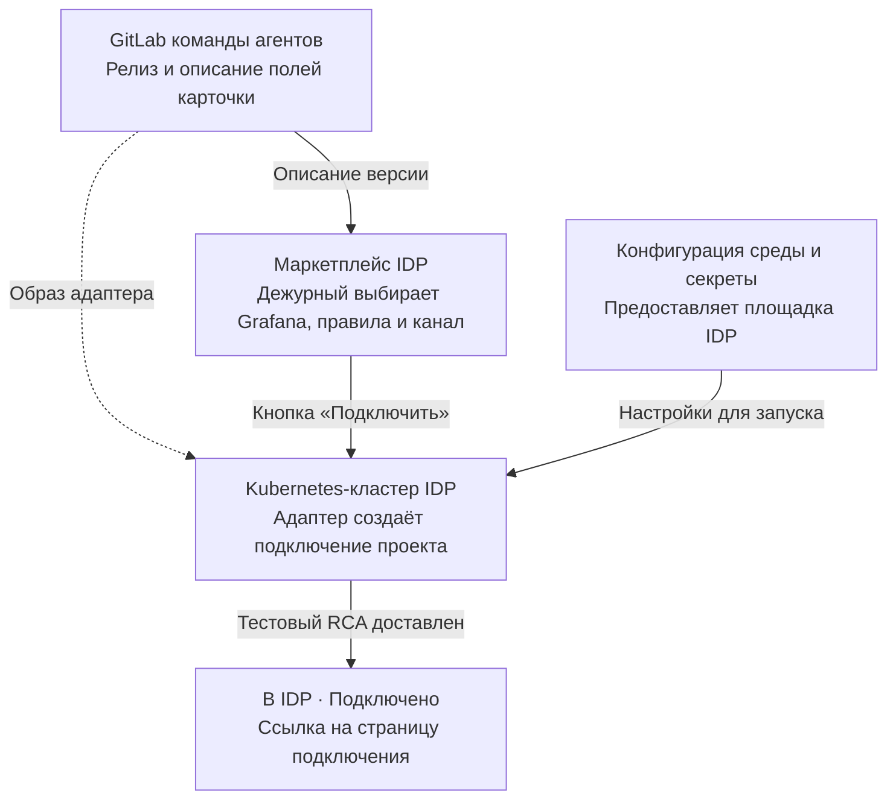
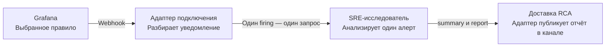

# Подключить SRE-агента к алертам Grafana

**Спецификация для команды корпоративного маркетплейса IDP · пилот HTTP 5xx**

Дежурный один раз открывает карточку в своём проекте, выбирает подключение Grafana, правила HTTP 5xx и канал RCA, затем нажимает **«Подключить»**. Автоматика создаёт проектное подключение в Kubernetes-кластере IDP. После выдачи кнопка **«Открыть подключение»** ведёт на страницу с выбранными правилами, каналом и результатом проверки. Каждый следующий подходящий алерт запускает расследование автоматически.

[Две схемы для обсуждения с командой IDP](../architecture.md)

## 1. От кнопки до готового подключения



### Что поставляем из GitLab и что означает env

Команда агентов выпускает код, контейнерный образ, описание запуска в Kubernetes и схему параметров карточки. Предлагаем связать `offeringId=sre-grafana-v1` с точным коммитом и образом по digest. При публикации IDP импортирует описание версии в каталог. При заказе автоматика использует закреплённую версию. Если адаптер уже работает в кластере, он регистрирует новое подключение проекта. Если для проекта предусмотрен отдельный экземпляр, автоматика развёртывает его из того же релиза. В обоих вариантах один заказ выдаёт одно подключение. Повторный алерт не требует нового заказа.

| Что настраивается | Кто и когда задаёт | Пример |
| --- | --- | --- |
| Контракт запуска | Команда агентов в репозитории релиза | Манифест запуска и `.env.example` с именами переменных, назначением и безопасными примерами. |
| Конфигурация окружения | Площадка при развёртывании в Kubernetes IDP | Например, `RCA_API_BASE_URL` содержит внутренний адрес исследователя. Namespace и адрес входящего webhook задаются для среды. |
| Секреты сервисов | Владельцы сервисов через хранилище секретов площадки | Учётные данные для входящего webhook, bearer RCA API и доступ к каналу. Исполнитель получает соответствующий секрет или ссылку на него. Значения секретов отсутствуют в Git-репозитории, форме, заказе и ссылке на подключение. |
| Настройки конкретного проекта | Дежурный и IDP один раз при заказе | Ссылки на зарегистрированные Grafana и канал, список правил. Адаптер хранит их в записи подключения. Общий адаптер выбирает настройки по подключению для каждого события. |

В примере описания релиза указаны адрес репозитория, образ адаптера, поля формы и два входа среды. Площадка передаёт адаптеру адрес RCA из конфигурации и подставляет токен по ссылке на секрет. Имена переменных иллюстративны. Для подключения настоящего релиза их сверяют с его репозиторием. [Пример релиза из GitLab](../examples/sre-grafana-offering.yaml)

### Карточка и источники полей

| Поле | Откуда берётся значение | Что проверяем |
| --- | --- | --- |
| Проект · `projectId` | Сервер IDP берёт активный проект из подтверждённой сессии. | IDP проверяет право дежурного подключать интеграции. Поставщик проверяет полномочия вызывающего клиента в проекте. |
| Версия и тип · `offeringId`, `resourceType` | Карточка релиза поставщика · `sre-grafana-v1`, `agent`. | Поставщик проверяет доступность версии проекту. |
| **Grafana** · `parameters.grafanaConnectionId` | Дежурный выбирает зарегистрированное подключение из доступных проекту. | Поставщик проверяет принадлежность и доступ проекта. Из профиля берёт разрешённый адрес Grafana, организацию и источники данных. |
| **Правила HTTP 5xx** · `parameters.ruleUids` | После выбора Grafana форма предлагает правила этой организации. Дежурный выбирает одно или несколько. | Каждый UID проверяется в выбранном подключении. Для каждого правила нужны привязка к сервису, источники и ссылка на логи. Если недоступно одно правило, отклоняется весь новый заказ. |
| **Канал RCA** · `parameters.deliveryChannelId` | Дежурный выбирает зарегистрированный канал, доступный проекту. | Поставщик проверяет область проекта, разрешение на отправку и адрес назначения. При приёмке дежурный проверяет, что видит сообщение. |

Для пилота предлагаем два уровня проверки. IDP фильтрует форму и проверяет право сотрудника при отправке. Поставщик до регистрации повторно сверяет проект и все ссылки по доверенному реестру. Угадывание ID другого проекта не даёт доступа. Для отсутствующей и недоступной ссылки возвращается одинаковый `404` без `orderId`. Если правило доступно, но не настроено для HTTP 5xx, — `422` с безопасной причиной.

### Итоговый заказ

Сохраняем три базовых поля. Выбор дежурного передаём тремя полями внутри `parameters`. Список правил содержит уникальные UID. Сервер IDP до первого вызова сохраняет ключ действия и исходное тело. [Контракт заказов](../openapi.yaml)

`POST /orders` · `Content-Type: application/json` · `Idempotency-Key: connect-checkout-demo-01`. Сервер IDP авторизуется в API поставщика своими служебными учётными данными.

```json
{
  "projectId": "team-checkout",
  "offeringId": "sre-grafana-v1",
  "resourceType": "agent",
  "parameters": {
    "grafanaConnectionId": "grafana-checkout",
    "ruleUids": ["checkout-5xx"],
    "deliveryChannelId": "rca-checkout"
  }
}
```

| Шаг | Исполнитель и вход | Результат для следующего шага |
| --- | --- | --- |
| 1. Принять заказ | IDP вызывает API с проверенным контекстом проекта и выбором дежурного. Сервис заказов проверяет ссылки и атомарно сохраняет заказ по ключу. | Новый заказ — HTTP `202`, `orderId=ord-checkout-01`, `status=queued`. IDP показывает «Принят». |
| 2. Подключить проект | Автоматический исполнитель получает заказ. Создаёт или находит связанную с ним запись `conn-checkout-01` и фиксирует профиль. Ещё до отправки тестового алерта подготавливает страницу со статусом проверки и пустой историей, затем настраивает маршрут выбранных правил к аутентифицированному приёмнику. | `GET /orders/ord-checkout-01` возвращает `in_progress`. Маршрут может принять тестовое событие. Страница имеет собственный адрес и доступ по SSO проекта независимо от истории расследований. |
| 3. Проверить маршрут | Автоматика проводит синтетический HTTP 5xx через выбранное правило Grafana, тот же приёмник, исследователь и выбранный канал. Контрольные данные позволяют получить полноценный RCA. В канале он помечается как тест подключения. | На странице подключения сохраняются результат теста, его `request_id` и подтверждение доставки. При временной неготовности заказ остаётся `in_progress`. При окончательной ошибке выдачи — `failed` и безопасное `error.message`. |
| 4. Показать результат | IDP читает терминальное состояние по `GET` и завершает опрос. | По `succeeded` показывает «Подключено» и ссылку на страницу. Её можно открыть до первого **боевого** алерта. По `failed` показывает причину и номер заказа. |

По `GET /orders/ord-checkout-01` успешная выдача выглядит так.

```json
{
  "orderId": "ord-checkout-01",
  "projectId": "team-checkout",
  "offeringId": "sre-grafana-v1",
  "resourceType": "agent",
  "status": "succeeded",
  "resourceRef": {
    "id": "conn-checkout-01",
    "url": "https://provider.example.invalid/connections/conn-checkout-01"
  }
}
```

## 2. От алерта до доставленного RCA



| Шаг | Исполнитель и вход | Результат |
| --- | --- | --- |
| 1. Принять уведомление | Grafana отправляет сырой webhook. Адаптер аутентифицирует отправителя. Привязка приёмника на сервере определяет `connectionId`, проект и ожидаемую Grafana. | Адаптер проверяет организацию и разбирает массив `alerts[]`. Поля входящего сообщения не могут переключить проект или канал доставки. |
| 2. Отобрать экземпляры | Адаптер рассматривает **каждый** элемент массива по его собственным статусу, UID правила и меткам. Обрабатывает `firing` выбранных правил HTTP 5xx с кодом от 500 до 599. Элемент `resolved` или уведомление о невыбранном правиле пропускает. | На каждый подходящий экземпляр сохраняет отдельную запись обработки. Для элемента с неполными данными фиксирует ошибку с привязкой к подключению. Остальные элементы группы продолжают обрабатываться. Получение группы подтверждается после надёжной записи результатов разбора. |
| 3. Начать расследование | Работник адаптера собирает тело из события и сохранённого профиля, сохраняет его вместе с `request_id`. Вызывает `POST /v1/investigations` с `Content-Type: application/json` и `Authorization: Bearer <токен RCA API>`. | POST ожидает результат. Работник может завершить расследование после того, как приёмник подтвердил получение webhook. |
| 4. Получить результат | При `200` работник читает `status`, `summary` и `report`. При `409 investigation_in_progress`, обрыве соединения или `504 http_wait_timeout` читает `GET /v1/investigations/{request_id}` с тем же правом доступа до результата. | При `completed` сохраняет RCA. При `insufficient_evidence` сохраняет отчёт с явной пометкой «Недостаточно данных для вывода». Завершённый повтор с тем же ID и телом может вернуть сохранённый результат с `reused=true`. |
| 5. Доставить отчёт | Работник доставки берёт сохранённые `summary` и `report` и канал из той же записи подключения. | В выбранном канале дежурный видит резюме и отчёт (текст либо доступное ему вложение). После подтверждения канала работник фиксирует идентификатор сообщения или квитанцию. Ошибка доставки видна на странице подключения. Для повторной доставки используется сохранённый отчёт. |

### Из чего собирается запрос исследователю

| Поля запроса RCA | Один раз при подключении | Для каждого экземпляра алерта |
| --- | --- | --- |
| `grafana.org_id`, `sources.logs_uid`, `sources.traces_uid`, `sources.metrics_uid` | Из зарегистрированной Grafana и её разрешённого профиля источников. В примере — организация `1`, UID `demo-logs`, `demo-traces`, `demo-metrics`. Поставщик сверяет доступ проекта ко всем трём источникам. | Адаптер проверяет соответствие отправителя и организации профилю и подставляет сохранённые UID. Для чтения данных исследователю нужны полномочия в этой области проекта. |
| `target.service` | При настройке проверяется привязка выбранного правила к сервису проекта. В примере для `checkout-5xx` зарегистрирован сервис `checkout`. Если привязки нет, заказ требует исправления. | Адаптер по UID правила подставляет сохранённый сервис. Произвольная метка сообщения не меняет цель расследования. |
| `references.logs_url` | Для выбранного правила сохраняется проверенный адрес или шаблон ссылки на **логи этого сервиса** в разрешённой Grafana и организации. Владелец мониторинга задаёт путь к дашборду и необходимые фильтры сервиса. | Адаптер строит ссылку по этому шаблону. Если нужен временной диапазон, привязывает его к `starts_at` и сохраняет готовый URL с телом запроса. Ссылка на правило Grafana сама по себе не указывает на нужные логи. |
| `alert.rule_uid`, `name`, `fingerprint`, `status`, `starts_at` | В маршруте правила нужно обеспечить передачу устойчивого UID. Для пилота предлагаем согласованную аннотацию `rule_uid`. Проверяем её наличие тестовым уведомлением. | Из одного `alerts[i]`: UID из согласованной аннотации, имя из `labels.alertname`, отпечаток из `fingerprint`, статус из `status`, время из `startsAt`. Адаптер сверяет UID с разрешёнными правилами подключения. |
| `alert.labels` | При подключении проверяется, что выбранное правило передаёт **все пять** меток HTTP 5xx. | Из `alerts[i].labels` берутся `api_name`, `api_method`, `api_endpoint`, `app_name`, `code`. Значения относятся к конкретному экземпляру. При отсутствующем поле адаптер не отправляет неполный запрос в RCA. |
| `schema_version`, `request_id` | Версия запроса для пилота — `1`. | Адаптер получает стабильный `request_id` из записи обработки эпизода и использует его при всех повторах. |

В действующем запросе к исследователю нет поля `projectId`. В примере один `RCA_API_TOKEN` обслуживает одну проектную область доступа. Если адаптер общий, он получает учётные данные RCA по доверенной привязке конкретного подключения к секрету проекта. Исследователь должен читать только разрешённые этому проекту данные. Страница подключения разрешает чтение результата по `request_id` только после проверки его связи с проектом вошедшего пользователя. При отзыве доступа к данным или каналу адаптер фиксирует ошибку соответствующего шага и сохраняет привязку к исходному проекту.

Стандартная полезная нагрузка webhook Grafana содержит массив алертов с их метками, аннотациями, временем и отпечатком. Формат конкретной инсталляции и передачу UID правила команды сверяют на тестовом уведомлении. [Документация Grafana Webhook](https://grafana.com/docs/grafana/latest/alerting/configure-notifications/manage-contact-points/integrations/webhook-notifier/)

Для этого алерта адаптер отправляет в действующий API исследователя следующее тело.

```json
{
  "schema_version": 1,
  "request_id": "checkout-5xx-001",
  "grafana": {"org_id": 1},
  "alert": {
    "rule_uid": "checkout-5xx",
    "fingerprint": "alert-instance-001",
    "name": "Checkout HTTP 5xx",
    "status": "firing",
    "starts_at": "2026-10-30T11:40:00Z",
    "labels": {
      "api_name": "checkout",
      "api_method": "POST",
      "api_endpoint": "/checkout",
      "app_name": "demo-store",
      "code": "503"
    }
  },
  "target": {"service": "checkout"},
  "sources": {"logs_uid": "demo-logs", "traces_uid": "demo-traces", "metrics_uid": "demo-metrics"},
  "references": {"logs_url": "https://grafana.example.invalid/d/demo-checkout/logs?orgId=1"}
}
```

### Как связать заказ, расследования и доставку

В примере связаны проект `team-checkout` → заказ `ord-checkout-01` → подключение `conn-checkout-01` → расследование `checkout-5xx-001` → сообщение в `rca-checkout`. У подключения может быть много расследований. Страница подключения читает их из проектной области доступа. Ошибка отдельного расследования или доставки отражается в истории подключения. Статус уже завершённого заказа сохраняется.

Предлагаемый ключ эпизода — `(projectId, connectionId, rule_uid, fingerprint, starts_at)`. Время нормализуется к UTC с сохранением точности. Первая обработка атомарно связывает ключ с уникальным `request_id` и неизменным снимком тела RCA. Конкурентная доставка той же группы находит эту запись. У повторного срабатывания после восстановления другое время начала и новый ID. При временной ошибке чтения результата работник продолжает с прежним ID. Срок хранения результата и порядок сверки, если RCA долго не находит ID после обрыва, предстоит согласовать с владельцем исследователя.

Для доставки адаптер хранит запись по `(connectionId, request_id, deliveryChannelId)`. Если канал поддерживает ключ повтора, использует его при повторной отправке. Если отправка оборвалась после публикации, работник сначала сверяет наличие сообщения с каналом. Когда канал не поддерживает такую сверку, страница показывает неопределённый исход доставки. Это отдельное событие от завершения расследования.

## Что уже работает и что нужно подключить

| Участник | Что есть и что предстоит сделать |
| --- | --- |
| Действующий SRE-исследователь | По переданному контракту принимает одиночные расследования через `POST /v1/investigations`, поддерживает HTTP 5xx и VIP, возвращает или позволяет дочитать результат по `request_id`. Для пилота выбран HTTP 5xx. В проекте также есть отдельный маршрут Telegram → Airflow → `POST /v1/rca`. В пилоте Grafana вызывает приёмник адаптера, а адаптер — `/v1/investigations`. |
| Предлагаемая работа команды агентов | Оформить релиз для каталога, реализовать регистрацию проектного подключения и страницу по SSO, приём сырого webhook, преобразование каждого алерта, хранение связей и результатов, доставку RCA, восстановление после сбоев и сквозную проверку. API исследователя даёт результат анализа. Отправку в канал нужно интегрировать отдельно. |

### Вопросы владельцам IDP

| Что нужно решить | Предложение для пилота и влияние на контракт |
| --- | --- |
| Как каталог принимает релизы из GitLab и как кнопка передаёт заказ? | Импортировать схему настроек версии, вызывать `POST /orders` с сохранённым ключом. От ответа зависят публикация карточки и восстановление заказа после тайм-аута. |
| Где зарегистрированы Grafana и каналы проекта и кто подтверждает права дежурного? | Показать в форме отфильтрованные ссылки, проверять их на сервере. От этого зависят списки выбора и проверка изоляции проектов. |
| Как исполнитель получает namespace проекта, адрес RCA API и проектные полномочия? | В Kubernetes IDP связать проект со служебной учётной записью, конфигурацией среды и ссылками на секреты. Это определяет, с чьими правами исследователь читает логи, трассировки и метрики. |
| Кто может автоматически настроить маршрут выбранных правил Grafana и откуда взять их привязку к сервису и логам? | Вместе с владельцем мониторинга согласовать аутентификацию webhook, аннотацию с UID правила и проектный реестр профилей. Это определяет преобразование webhook в запрос исследователю. |
| Как подтвердить доставку при повторной отправке и как дежурный проверит результат? | Для первого канала выбрать способ получить квитанцию или найти сообщение по устойчивому ключу. Согласовать синтетический сигнал и точку просмотра отчёта для приёмки «Подключено». |

## Приёмка

1. **Двойное нажатие и потеря первого ответа.** Два параллельных `POST /orders` с одним ключом и телом создают один заказ, одно подключение и один маршрут Grafana. Повтор после тайм-аута возвращает HTTP `200`, тот же `orderId` и текущее состояние. Изменение канала или правил с тем же ключом даёт `409`.
2. **Группа и повторные доставки.** Отправить группу с двумя подходящими `firing` и одним `resolved`. Ожидать два расследования и два отчёта. Повторить группу в другом порядке, в том числе параллельно. У каждого эпизода сохраняется его ID. Отдельно смоделировать `409 investigation_in_progress`, разрыв и `504 http_wait_timeout` — работник дочитывает прежнее расследование. Повтор отправки сообщения в канал использует тот же результат. Новое срабатывание с новым `starts_at` даёт отдельное расследование.
3. **Изоляция двух проектов.** Зарегистрировать проекты A и B с разными Grafana и каналами. Заказ A со ссылкой на ресурс B отклоняется до регистрации. Отправить одинаковые UID правила и отпечатки через каждое из двух авторизованных подключений. Ожидать разные `request_id`, чтение только разрешённых каждому проекту источников и отчёты только в своём канале. Подмена проекта, URL логов или UID источника в webhook не меняет маршрут. Пользователь A не может открыть страницу или отчёт B. Чтение RCA через интеграцию проверяет проект по записи расследования.
4. **Доставка при нехватке данных и при сбое канала.** Для `insufficient_evidence` дежурный получает резюме и отчёт с явным указанием недостатка данных. При сбое канала результат анализа сохраняется, состояние доставки видно на странице. После восстановления доставка завершается без нового расследования.

**Критерий «Подключено».** Синтетический HTTP 5xx с тестовыми данными прошёл через **выбранное правило Grafana**, реальный маршрут webhook и `POST /v1/investigations`. Исследователь вернул `completed`. Адаптер получил подтверждение публикации, а дежурный **открыл выбранный канал и увидел RCA** этого теста с резюме и отчётом. На странице подключения виден тот же `request_id`. Это проверяется до первого боевого алерта.
