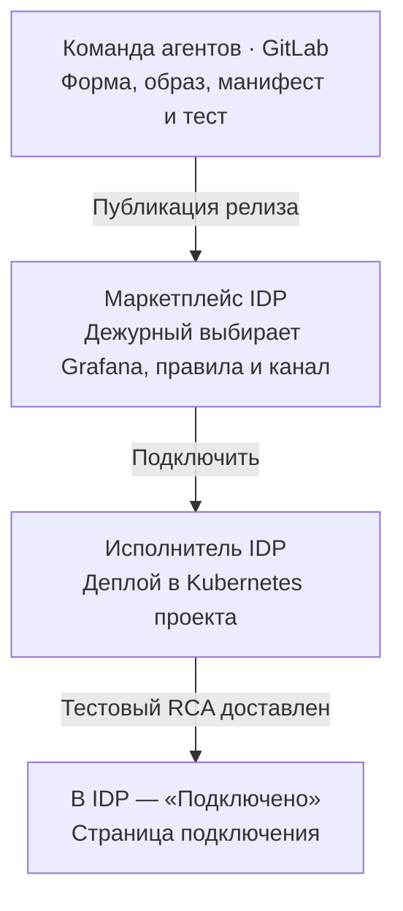
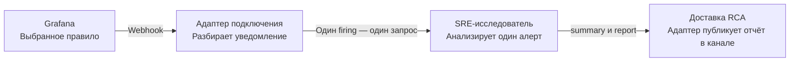

# Подключить SRE-агента к алертам Grafana

**Спецификация для команды корпоративного маркетплейса IDP · пилот HTTP 5xx**

Дежурный один раз открывает карточку в своём проекте, выбирает подключение Grafana, правила HTTP 5xx и канал RCA, затем нажимает **«Подключить»**. Автоматика создаёт проектное подключение в Kubernetes-кластере IDP. После выдачи кнопка **«Открыть подключение»** ведёт на страницу с выбранными правилами, каналом и результатом проверки. Каждый следующий подходящий алерт запускает расследование автоматически.

[Две схемы для обсуждения с командой IDP](../architecture.md)

## 1. От кнопки до готового подключения

В основном варианте заказ, ключ повтора и статус выдачи ведёт IDP. По кнопке «Подключить» её исполнитель применяет релиз в своём Kubernetes-кластере. Контракт между командами на этапе выдачи — версионированный артефакт, параметры его запуска и проверка результата. Во время работы адаптер обращается к действующему RCA API. Для примера предполагаем один экземпляр адаптера на проектное подключение и доступный из кластера исследователь.



### Что передаёт команда агентов

| Артефакт | Что получает инженер маркетплейса |
| --- | --- |
| Карточка и форма | Описание `sre-grafana-v1`, владелец поддержки, версия и схема трёх полей — `grafanaConnectionId`, `ruleUids`, `deliveryChannelId`. Список правил зависит от выбранной Grafana. [Пример описания релиза](../examples/sre-grafana-offering.yaml) |
| Релиз для Kubernetes | Ссылка на GitLab с полным SHA коммита, собранный образ адаптера по digest, манифесты запуска из этого коммита и инструкция подстановки параметров. Если стандарт IDP — Helm, эквивалентная поставка — chart с `values.yaml` и `values.schema.json`. В поставке также указываются порт, проверка работоспособности, необходимые сетевые доступы и ресурсы для пилота. |
| Конфигурация и права | Формат проектной конфигурации, список env и требования к правам. Для примера `RCA_API_BASE_URL` берётся из конфигурации среды, а `RCA_API_TOKEN` — из проектного секрета. Отдельно описываются аутентификация входящего webhook, права на выбранные источники и отправку в канал. |
| Рабочий адаптер и приёмка | Приём webhook Grafana, преобразование каждого подходящего алерта в запрос исследователю, восстановление после повторов и доставка RCA. Команда агентов указывает маршрут страницы подключения, поставляет процедуру сквозного теста, контрольные данные и ожидаемый результат. |

Конкретные адреса, SHA и digest из примера вымышлены. Для стенда команда агентов подставляет реквизиты доступного релиза. Из перечисленного сейчас описан действующий исследователь. Адаптер, регистрацию маршрута, страницу подключения и доставку ещё предстоит реализовать.

### Что подставляет IDP при нажатии кнопки

Пример проектной конфигурации, которую исполнитель IDP передаёт адаптеру при развёртывании (например, файлом `connection.yaml` из ConfigMap).

```yaml
projectId: team-checkout
connectionId: conn-checkout-01
grafanaConnectionId: grafana-checkout
ruleUids: [checkout-5xx]
deliveryChannelId: rca-checkout
```

`projectId` приходит из сессии, `connectionId` один раз назначает IDP и сохраняет для повторов этого заказа. Последние три значения выбирает дежурный. IDP проверяет его право на выбор. Адаптер по доверенному реестру проверяет принадлежность ссылок проекту и получает из профиля правила организацию Grafana, целевой сервис, три UID источников и шаблон ссылки на логи. Настоящие адреса и учётные данные предоставляет владелец среды.

1. **IDP принимает заказ и разворачивает релиз.** По `projectId` выбирает namespace, передаёт конфигурацию и ссылки на секреты, применяет манифест и настраивает внутреннюю точку входа. Повтор использует тот же `connectionId` и сверяет существующую установку и продолжает с теми же версией и настройками.
2. **Адаптер подключает правило.** В предлагаемом пилоте шаг настройки из релиза регистрирует аутентифицированный приёмник в Grafana и привязывает к нему выбранные правила в пределах проекта. Владелец Grafana заранее разрешает эту операцию либо предоставляет готовый маршрут. Страница подключения открывается по корпоративному входу ещё до первого алерта.
3. **IDP проверяет результат и открывает доступ.** После запуска контейнера IDP выполняет проверку из релиза (в примере — тестовый Kubernetes Job). Тест сохраняет `request_id` и квитанцию канала и только затем завершается успешно. Синтетический HTTP 5xx проходит через выбранное правило и `POST /v1/investigations`, затем канал подтверждает доставку RCA. По успешному результату IDP сохраняет итог в своём заказе и показывает «Подключено» и ссылку на страницу подключения по SSO. На приёмке дежурный открывает канал и сверяет отчёт. При сбое IDP показывает, на каком шаге остановилось подключение.

### Карточка и источники полей

| Поле | Кто предоставляет | Кто проверяет |
| --- | --- | --- |
| `projectId`, инициатор | IDP определяет проект и пользователя по своей сессии. | Сервер IDP проверяет право подключать интеграции в проекте. |
| `offeringId`, образ, описание запуска | Команда агентов публикует релиз `sre-grafana-v1`. | Исполнитель IDP использует версию карточки и закреплённый за ней digest. |
| `grafanaConnectionId` | Дежурный выбирает зарегистрированную Grafana. | IDP фильтрует список по проекту и проверяет выбор на сервере. Адаптер по доверенному реестру определяет организацию и профиль источников. |
| `ruleUids` | Дежурный выбирает одно или несколько уникальных правил HTTP 5xx в выбранной Grafana. | Каждое правило должно быть доступно проекту и иметь привязку к сервису, источникам и логам. Недопустимый выбор останавливает подключение целиком. |
| `deliveryChannelId` | Дежурный выбирает зарегистрированный канал RCA. | IDP проверяет право выбора. Адаптер проверяет адресат и отправку с разрешёнными полномочиями проекта. |
| `connectionId` | IDP выделяет идентификатор и сохраняет его с заказом до запуска. | Повтор установки привязывается к тому же подключению и маршруту Grafana. |

Выпуск и приёмка опираются на описание релиза и на конфигурацию, которую IDP передаёт адаптеру. У платформ с другим механизмом выдачи возможен [альтернативный API заказов поставщика](../openapi.yaml).

## 2. От алерта до доставленного RCA



| Шаг | Исполнитель и вход | Результат |
| --- | --- | --- |
| 1. Принять уведомление | Grafana отправляет сырой webhook. Адаптер аутентифицирует отправителя. Привязка приёмника на сервере определяет `connectionId`, проект и ожидаемую Grafana. | Адаптер проверяет организацию и разбирает массив `alerts[]`. Поля входящего сообщения не могут переключить проект или канал доставки. |
| 2. Отобрать экземпляры | Адаптер рассматривает **каждый** элемент массива по его собственным статусу, UID правила и меткам. Обрабатывает `firing` выбранных правил HTTP 5xx с кодом от 500 до 599. Элемент `resolved` или уведомление о невыбранном правиле пропускает. | На каждый подходящий экземпляр сохраняет отдельную запись обработки. Для элемента с неполными данными фиксирует ошибку с привязкой к подключению. Остальные элементы группы продолжают обрабатываться. Получение группы подтверждается после надёжной записи результатов разбора. |
| 3. Начать расследование | Работник адаптера собирает тело из события и сохранённого профиля, сохраняет его вместе с `request_id`. Вызывает `POST /v1/investigations` с `Content-Type: application/json` и `Authorization: Bearer <токен RCA API>`. | POST ожидает результат. Работник может завершить расследование после того, как приёмник подтвердил получение webhook. |
| 4. Получить результат | При `200` работник читает `status`, `summary` и `report`. При `409 investigation_in_progress`, обрыве соединения или `504 http_wait_timeout` читает `GET /v1/investigations/{request_id}` с тем же правом доступа до результата. | При `completed` сохраняет RCA. При `insufficient_evidence` сохраняет отчёт с явной пометкой «Недостаточно данных для вывода». Завершённый повтор с тем же ID и телом может вернуть сохранённый результат с `reused=true`. |
| 5. Доставить отчёт | Работник доставки берёт сохранённые `summary` и `report` и канал из той же записи подключения. | В выбранном канале дежурный видит резюме и отчёт (текст либо доступное ему вложение). После подтверждения канала работник фиксирует идентификатор сообщения или квитанцию. Ошибка доставки видна на странице подключения. Для повторной доставки используется сохранённый отчёт. |

### Из чего собирается запрос исследователю

| Поля запроса RCA | Один раз при подключении | Для каждого экземпляра алерта |
| --- | --- | --- |
| `grafana.org_id`, `sources.logs_uid`, `sources.traces_uid`, `sources.metrics_uid` | Из зарегистрированной Grafana и её разрешённого профиля источников. В примере — организация `1`, UID `demo-logs`, `demo-traces`, `demo-metrics`. Адаптер сверяет доступ проекта ко всем трём источникам. | Адаптер проверяет соответствие отправителя и организации профилю и подставляет сохранённые UID. Для чтения данных исследователю нужны полномочия в этой области проекта. |
| `target.service` | При настройке проверяется привязка выбранного правила к сервису проекта. В примере для `checkout-5xx` зарегистрирован сервис `checkout`. Если привязки нет, заказ требует исправления. | Адаптер по UID правила подставляет сохранённый сервис. Произвольная метка сообщения не меняет цель расследования. |
| `references.logs_url` | Для выбранного правила сохраняется проверенный адрес или шаблон ссылки на **логи этого сервиса** в разрешённой Grafana и организации. Владелец мониторинга задаёт путь к дашборду и необходимые фильтры сервиса. | Адаптер строит ссылку по этому шаблону. Если нужен временной диапазон, привязывает его к `starts_at` и сохраняет готовый URL с телом запроса. Ссылка на правило Grafana сама по себе не указывает на нужные логи. |
| `alert.rule_uid`, `name`, `fingerprint`, `status`, `starts_at` | В маршруте правила нужно обеспечить передачу устойчивого UID. Для пилота предлагаем согласованную аннотацию `rule_uid`. Проверяем её наличие тестовым уведомлением. | Из одного `alerts[i]`: UID из согласованной аннотации, имя из `labels.alertname`, отпечаток из `fingerprint`, статус из `status`, время из `startsAt`. Адаптер сверяет UID с разрешёнными правилами подключения. |
| `alert.labels` | При подключении проверяется, что выбранное правило передаёт **все пять** меток HTTP 5xx. | Из `alerts[i].labels` берутся `api_name`, `api_method`, `api_endpoint`, `app_name`, `code`. Значения относятся к конкретному экземпляру. При отсутствующем поле адаптер не отправляет неполный запрос в RCA. |
| `schema_version`, `request_id` | Версия запроса для пилота — `1`. | Адаптер получает стабильный `request_id` из записи обработки эпизода и использует его при всех повторах. |

В действующем запросе к исследователю нет поля `projectId`. В примере один `RCA_API_TOKEN` обслуживает одну проектную область доступа. Если адаптер общий, он получает учётные данные RCA по доверенной привязке конкретного подключения к секрету проекта. Исследователь должен читать только разрешённые этому проекту данные. Страница подключения разрешает чтение результата по `request_id` только после проверки его связи с проектом вошедшего пользователя. При отзыве доступа к данным или каналу адаптер фиксирует ошибку соответствующего шага и сохраняет привязку к исходному проекту.

Стандартная полезная нагрузка webhook Grafana содержит массив алертов с их метками, аннотациями, временем и отпечатком. Формат конкретной инсталляции и передачу UID правила команды сверяют на тестовом уведомлении. [Документация Grafana Webhook](https://grafana.com/docs/grafana/latest/alerting/configure-notifications/manage-contact-points/integrations/webhook-notifier/)

Для этого алерта адаптер отправляет в действующий API исследователя следующее тело.

```json
{
  "schema_version": 1,
  "request_id": "checkout-5xx-001",
  "grafana": {"org_id": 1},
  "alert": {
    "rule_uid": "checkout-5xx",
    "fingerprint": "alert-instance-001",
    "name": "Checkout HTTP 5xx",
    "status": "firing",
    "starts_at": "2026-10-30T11:40:00Z",
    "labels": {
      "api_name": "checkout",
      "api_method": "POST",
      "api_endpoint": "/checkout",
      "app_name": "demo-store",
      "code": "503"
    }
  },
  "target": {"service": "checkout"},
  "sources": {"logs_uid": "demo-logs", "traces_uid": "demo-traces", "metrics_uid": "demo-metrics"},
  "references": {"logs_url": "https://grafana.example.invalid/d/demo-checkout/logs?orgId=1"}
}
```

### Как связать заказ, расследования и доставку

В примере связаны проект `team-checkout` → заказ `ord-checkout-01` → подключение `conn-checkout-01` → расследование `checkout-5xx-001` → сообщение в `rca-checkout`. У подключения может быть много расследований. Страница подключения читает их из проектной области доступа. Ошибка отдельного расследования или доставки отражается в истории подключения. Статус уже завершённого заказа сохраняется.

Предлагаемый ключ эпизода — `(projectId, connectionId, rule_uid, fingerprint, starts_at)`. Время нормализуется к UTC с сохранением точности. Первая обработка атомарно связывает ключ с уникальным `request_id` и неизменным снимком тела RCA. Конкурентная доставка той же группы находит эту запись. У повторного срабатывания после восстановления другое время начала и новый ID. При временной ошибке чтения результата работник продолжает с прежним ID. Срок хранения результата и порядок сверки, если RCA долго не находит ID после обрыва, предстоит согласовать с владельцем исследователя.

Для доставки адаптер хранит запись по `(connectionId, request_id, deliveryChannelId)`. Если канал поддерживает ключ повтора, использует его при повторной отправке. Если отправка оборвалась после публикации, работник сначала сверяет наличие сообщения с каналом. Когда канал не поддерживает такую сверку, страница показывает неопределённый исход доставки. Это отдельное событие от завершения расследования.

## Что уже работает и что нужно подключить

| Участник | Что есть и что предстоит сделать |
| --- | --- |
| Действующий SRE-исследователь | По переданному контракту принимает одиночные расследования через `POST /v1/investigations`, поддерживает HTTP 5xx и VIP, возвращает или позволяет дочитать результат по `request_id`. Для пилота выбран HTTP 5xx. В проекте также есть отдельный маршрут Telegram → Airflow → `POST /v1/rca`. В пилоте Grafana вызывает приёмник адаптера, а адаптер — `/v1/investigations`. |
| Предлагаемая работа команды агентов | Оформить релиз для каталога, реализовать регистрацию проектного подключения и страницу по SSO, приём сырого webhook, преобразование каждого алерта, хранение связей и результатов, доставку RCA, восстановление после сбоев и сквозную проверку. API исследователя даёт результат анализа. Отправку в канал нужно интегрировать отдельно. |

### Вопросы владельцам IDP

| Что нужно решить | Предложение для пилота и влияние на контракт |
| --- | --- |
| Как каталог импортирует релиз из GitLab и применяет настройки по кнопке? | IDP использует схему формы из релиза, свой заказ и исполнитель Kubernetes. Нужно согласовать привязку проекта к namespace, формат конфигурации адаптера и получение результата сквозного теста. |
| Где зарегистрированы Grafana и каналы проекта и кто подтверждает права дежурного? | Показать в форме отфильтрованные ссылки, проверять их на сервере. От этого зависят списки выбора и проверка изоляции проектов. |
| Как исполнитель получает namespace проекта, адрес RCA API и проектные полномочия? | В Kubernetes IDP связать проект со служебной учётной записью, конфигурацией среды и ссылками на секреты. Это определяет, с чьими правами исследователь читает логи, трассировки и метрики. |
| Кто может автоматически настроить маршрут выбранных правил Grafana и откуда взять их привязку к сервису и логам? | Вместе с владельцем мониторинга согласовать аутентификацию webhook, аннотацию с UID правила и проектный реестр профилей. Это определяет преобразование webhook в запрос исследователю. |
| Как подтвердить доставку при повторной отправке и как дежурный проверит результат? | Для первого канала выбрать способ получить квитанцию или найти сообщение по устойчивому ключу. Согласовать синтетический сигнал и точку просмотра отчёта для приёмки «Подключено». |

## Приёмка

1. **Двойное нажатие и потеря ответа IDP.** Нажать «Подключить» дважды, потерять ответ интерфейса и закрыть страницу. При возврате IDP восстанавливает свой заказ, прежний `connectionId`, одну установку и один маршрут Grafana. Перезапуск исполнителя использует исходные версию и параметры. Намеренное новое подключение получает новый ID.
2. **Группа и повторные доставки.** Отправить группу с двумя подходящими `firing` и одним `resolved`. Ожидать два расследования и два отчёта. Повторить группу в другом порядке, в том числе параллельно. У каждого эпизода сохраняется его ID. Отдельно смоделировать `409 investigation_in_progress`, разрыв и `504 http_wait_timeout` — работник дочитывает прежнее расследование. Повтор отправки сообщения в канал использует тот же результат. Новое срабатывание с новым `starts_at` даёт отдельное расследование.
3. **Изоляция двух проектов.** Зарегистрировать проекты A и B с разными Grafana и каналами. IDP отклоняет выбор ресурса B для проекта A до развёртывания. Отправить одинаковые UID правила и отпечатки через каждое из двух авторизованных подключений. Ожидать разные `request_id`, чтение только разрешённых каждому проекту источников и отчёты только в своём канале. Подмена проекта, URL логов или UID источника в webhook не меняет маршрут. Пользователь A не может открыть страницу или отчёт B. Чтение RCA через интеграцию проверяет проект по записи расследования.
4. **Доставка при нехватке данных и при сбое канала.** Для `insufficient_evidence` дежурный получает резюме и отчёт с явным указанием недостатка данных. При сбое канала результат анализа сохраняется, состояние доставки видно на странице. После восстановления доставка завершается без нового расследования.

**Критерий «Подключено».** Синтетический HTTP 5xx с тестовыми данными прошёл через **выбранное правило Grafana**, реальный маршрут webhook и `POST /v1/investigations`. Исследователь вернул `completed`. Адаптер получил подтверждение публикации, а дежурный **открыл выбранный канал и увидел RCA** этого теста с резюме и отчётом. На странице подключения виден тот же `request_id`. Это проверяется до первого боевого алерта.
