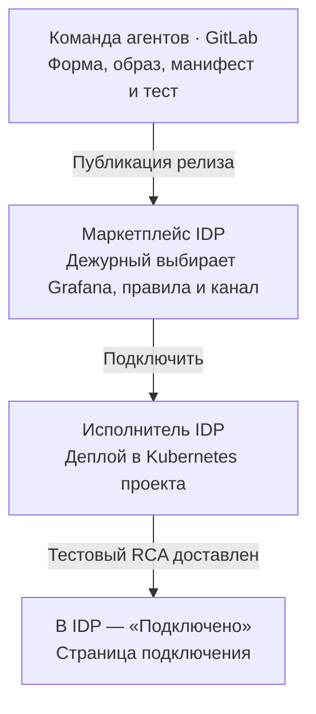
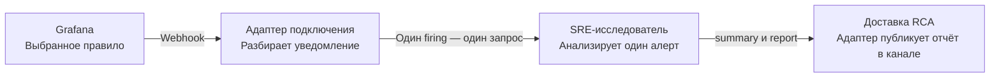

# SRE-агент и алерты Grafana

## 1. Дежурный один раз подключает проект

Команда агентов передаёт форму из GitLab, образ по digest, манифесты или Helm chart, требования к env и сквозной тест. Дежурный выбирает Grafana, правила и канал. По кнопке IDP сохраняет свой заказ и `connectionId`, применяет релиз в namespace проекта и подставляет секреты. Тестовый RCA в выбранном канале разрешает IDP показать «Подключено» и ссылку на страницу.

## 2. Каждый подходящий алерт запускает расследование

Для одного уведомления с двумя подходящими экземплярами алерта адаптер создаёт два расследования. Оба отчёта попадают в канал, выбранный при подключении проекта.

[Полная спецификация и критерии приёмки](agents/sre-grafana.md) · [Пример релиза из GitLab](examples/sre-grafana-offering.yaml) · [Альтернативный API заказов поставщика](openapi.yaml)
