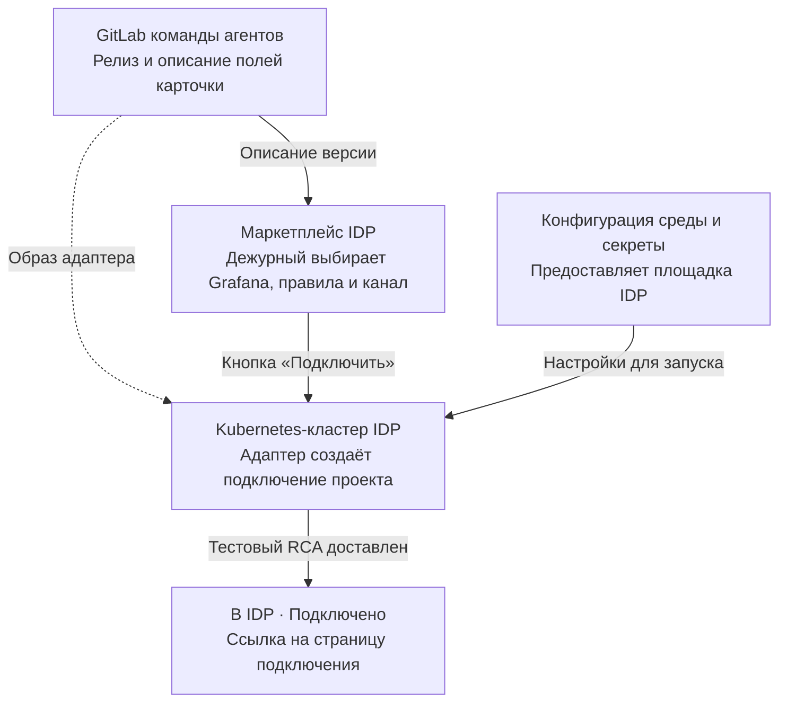
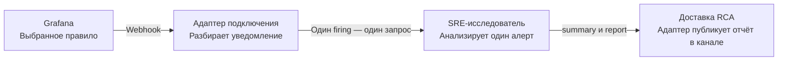

# SRE-агент и алерты Grafana

## 1. Дежурный один раз подключает проект

GitLab задаёт, **что запускать**. Конфигурация окружения Kubernetes задаёт, **как адаптер обращается к сервисам**. Из карточки заказа приходят три выбора дежурного — Grafana, правила и канал доставки.

## 2. Каждый подходящий алерт запускает расследование

Для одного уведомления с двумя подходящими экземплярами алерта адаптер создаёт два расследования. Оба отчёта попадают в канал, выбранный при подключении проекта.

[Полная спецификация и критерии приёмки](agents/sre-grafana.md) · [Пример релиза из GitLab](examples/sre-grafana-offering.yaml) · [API заказов](openapi.yaml)
